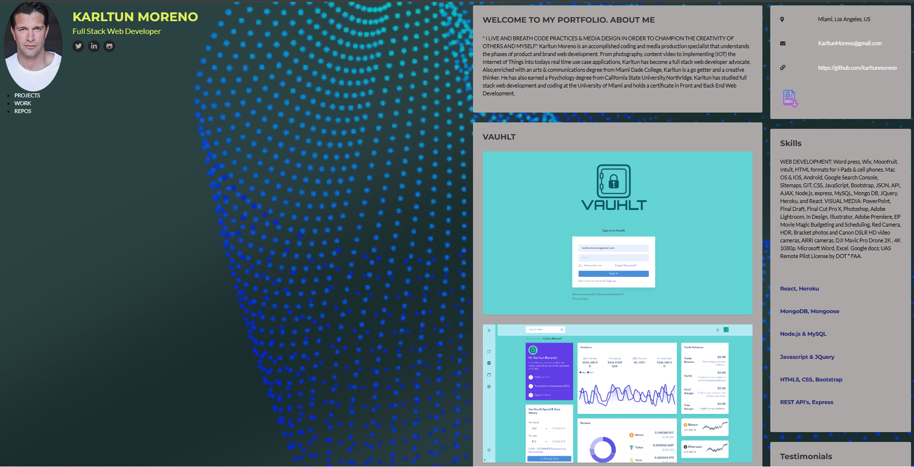

# 🚀 My Portfolio & Blog

  A responsive developer portfolio showcasing my work, skills, and contact information.

  
  
  

---

## 📚 Table of Contents

- [About The Project](#-about-the-project)
- [Tech Stack](#-tech-stack)
- [Features](#-features)
- [Project Criteria](#-project-criteria)
- [Live Project](#-live-project)
- [Contact](#-contact)
- [Credits](#-credits)

---

## 📖 About The Project

This is my personal portfolio project, built to present:

- 👨‍💻 My background and achievements  
- 🧩 Projects and repositories I’ve worked on  
- 📬 Easy ways to connect with me  

It is designed with responsiveness in mind so it looks great on desktop, tablet, and mobile devices.

---

## 🛠 Tech Stack

### Front-End

---

## ✨ Features

- ✅ Fully responsive layout
- ✅ Clean and modern UI
- ✅ Portfolio project cards with links
- ✅ Smooth section navigation
- ✅ Built using HTML5, CSS3, JavaScript, and Bootstrap 5
- ✅ SCSS source support
- ✅ Font Awesome icon integration

---

## 🧪 Project Criteria

- Display developer name, photo/avatar, and navigation links  
- Navigation scrolls to each relevant section  
- Work section includes titled project images  
- First project is visually emphasized  
- Clicking project images opens deployed applications  
- Responsive behavior across different screen sizes  

---

## 🌐 Live Project

🔗 **Deployed Site:**  
https://maxkarltun.github.io/My-Portfolio/

---

## 📬 Contact

**Max Karltun**  
📧 karltunmoreno@gmail.com  
💼 [LinkedIn] https://www.linkedin.com/in/max-karltun-0a910a46/

---

## 🙌 Credits

- [Bootstrap](http://getbootstrap.com/)
- [FontAwesome](http://fortawesome.github.io/Font-Awesome/)
- [GitHub Activity Stream](http://caseyscarborough.com/projects/github-activity/)
- [GitHub Calendar Plugin](https://github.com/karltunmoreno/github-calendar)
- [Vanilla RSS](https://github.com/sdepold/jquery-rss)

---

  Thanks for visiting! ⭐ If you like this project, consider giving it a star.

